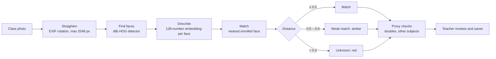

# RollCall AI

**Attendance from one photo of the class.** A teacher photographs the room (or records a quick voice roll call), RollCall marks the register, flags anything suspicious, and the teacher checks it before saving.

**[Open the app](https://rollcall-ai.streamlit.app)** · **[Landing page](https://roll-call-ai.vercel.app)**

Built for the real moment it's used: a teacher at the front of a classroom, phone in one hand. In Indian colleges, where 75% attendance is often required to sit exams, roll call eats into every lecture and "proxy" attendance (answering for an absent friend) is common. RollCall goes after both.

---

## What it does

**For teachers**
- **Take attendance from a class photo.** Every face is found, matched to the subject's roster, and boxed and named on the photo. Each ticked name shows the face it was matched to, so a mistake is visible at a glance.
- **Or by voice.** Students say "present" in turn; each voice is matched to the student's voice sample.
- **Proxy checks before anything is saved.** Faces nobody matched, the same student matched twice, a student from another subject, weak matches, and a voice that answers twice are all flagged.
- **A live scan timeline.** Each stage (prepare photo, find faces, match, check) ticks off with its timing, so the AI's work is visible rather than hidden behind a spinner.
- **An editable register.** Filters for *All*, *Absent* and *To check*. Nothing is saved until the teacher presses Save, and a register can always be marked by hand.
- **Records.** Classes taken, average attendance with a trend line, students below 75%, a full register grid (student × class), and a CSV export.
- **Subjects with join codes.** Each subject gets a code, a QR code and a join link.

**For students**
- Sign in with a selfie (no password), join subjects by code or QR, and see attendance per subject against the 75% minimum.
- Add or replace a voice sample at any time.

---

## How the face matching works



- **Embeddings, not photos.** dlib's ResNet model turns each face into 128 numbers; it scores 99.38% on the LFW face benchmark. Two photos of the same person sit less than 0.6 apart (Euclidean distance). In testing with public-domain portraits, the same face came out 0.09 and 0.16 apart, and a different person 0.69.
- **Nearest neighbour, not a classifier.** Every enrolled face sits in one matrix, so matching a face is a single vectorised distance calculation. An earlier version trained an SVM and retrained it every time a student signed up; nearest neighbour with dlib's own threshold is simpler, standard for this kind of embedding, and needs no retraining.
- **One person can only appear once per photo.** If two faces match the same student, the closer one counts and the other is flagged.
- **Phone photos are straightened and resized first.** Phones save photos sideways and record the rotation in EXIF, and dlib only finds upright faces. Full 12 MP photos also upsample to a size that can exhaust server memory, so photos are capped at 2048 px, which still leaves back-row faces large enough to detect.

**Voice** works the same way: the recording is split at pauses, each "present" becomes a 256-number Resemblyzer embedding, and it counts as a match at a cosine similarity of 0.65 or more (0.65–0.75 is shown as weak). A student whose voice answers twice is flagged as a possible proxy.

---

## Privacy decisions

- **Class photos are never stored.** They're scanned in the session and discarded.
- **Students are stored as numbers, not pictures.** A selfie becomes a 128-number face embedding; a voice sample becomes 256 numbers.
- **Teachers only see names from their own roster.** A face that matches a student from another teacher's subject is reported as "not enrolled", never named, so a photo can't be used to identify students in other classes.
- **The camera only starts when asked.** The in-app camera is created only when the teacher opens it.
- **Teacher passwords** are stored as bcrypt hashes.

---

## Tech stack

| Part | Built with |
|---|---|
| App | Python, Streamlit |
| Face recognition | dlib (HOG detector + ResNet face embeddings), NumPy, Pillow |
| Voice recognition | Resemblyzer, librosa, WebRTC VAD |
| Database | Supabase (PostgreSQL) |
| Landing page | Flask, HTML, CSS, vanilla JavaScript, on Vercel |

---

## Project structure

```
ai-attendance-project-app/          Streamlit app
├── app.py                          entry point and routing
├── src/
│   ├── screens/                    home, teacher and student screens
│   ├── components/                 review screen, scan timeline, dialogs, cards
│   ├── pipelines/
│   │   ├── face_pipeline.py        detection, embeddings, nearest-face matching
│   │   ├── voice_pipeline.py       splitting a recording and matching voices
│   │   ├── roll_call.py            turns matches into a register plus proxy flags
│   │   └── annotate.py             boxes on the photo, face close-ups
│   ├── database/                   Supabase client and queries
│   └── ui/                         theme (style.css), formatting, navigation
└── scripts/seed_demo.py            creates an optional demo class

ai-attendance-project-landing/      Flask landing page (Vercel)
```

The scan logic in `roll_call.py` is plain Python with no UI code, so it can be tested on its own; the screens only display what it returns.

### Database tables

| Table | Holds |
|---|---|
| `teachers` | username, name, bcrypt password hash |
| `students` | name, face embedding, optional voice embedding |
| `subjects` | code, name, section, owning teacher |
| `subject_students` | which students are enrolled in which subject |
| `attendance_logs` | student, subject, UTC timestamp, present or absent |

---

## Running it locally

Python 3.12 is recommended; `dlib` and `torch` wheels are most reliable there.

```bash
cd ai-attendance-project-app
python -m venv .venv
.venv/bin/pip install -r requirements.txt        # Windows: .venv\Scripts\pip
```

On Windows, `webrtcvad` needs a C compiler. Install everything except `resemblyzer`, then add it without its dependencies (`webrtcvad-wheels` in the requirements provides the same module):

```powershell
Get-Content requirements.txt | Where-Object { $_ -notmatch '^\s*resemblyzer' } | Set-Content "$env:TEMP\rollcall-req.txt"
.venv\Scripts\pip install -r "$env:TEMP\rollcall-req.txt"
.venv\Scripts\pip install --no-deps resemblyzer
```

Add `.streamlit/secrets.toml` (it's gitignored):

```toml
SUPABASE_URL = "https://your-project.supabase.co"
SUPABASE_KEY = "your-key"
# DEMO_TEACHER = "demo"   # shows "Try a demo class" after running scripts/seed_demo.py
```

Then run `streamlit run app.py`. The landing page runs with `pip install -r requirements.txt` and `python app.py` in `ai-attendance-project-landing`.

---

## Limitations and what I'd do next

- **Liveness.** Selfie sign-in can be fooled by a printed photo of a student. Next step: a second selfie with a head turn, checked against dlib's facial landmarks.
- **Scaling the face search.** Matching loads every enrolled face into memory. For thousands of students, I'd move the embeddings into Postgres with `pgvector` and search there.
- **Database access.** The app talks to Supabase with one server-side key; row-level security policies per teacher would add defence in depth.
- **Accuracy in real classrooms.** Back rows, side angles and poor light all reduce detection. That's why every result is reviewed by the teacher, weak matches are highlighted, and attendance can always be marked by hand.

---

Built by **Sahil Agarwal** · [LinkedIn](https://www.linkedin.com/in/sahil-agarwal-1761a8317) · [GitHub](https://github.com/SAHIL-AGARWAL-IN)
